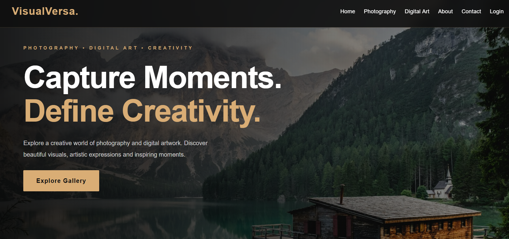
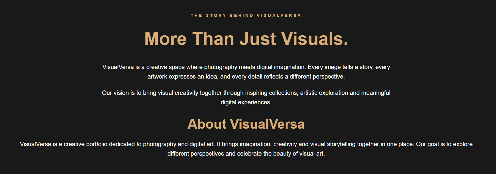
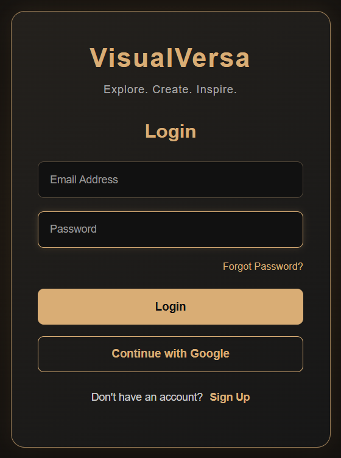
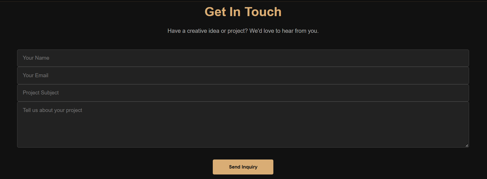

# VisualVersa 🎨

A photography and digital art portfolio website with login and a working contact form.

🔗 **Live demo:** https://visualversa.vercel.app

## Screenshots

## Features
- Responsive gallery with Photography / Digital Art filters
- Login and signup using Firebase Authentication
- Contact form that saves data to Google Sheets (Google Apps Script)
- Automatic confirmation email to the user
- Deployed on Vercel

## Tech Stack
HTML, CSS, JavaScript, Firebase, Google Apps Script, Vercel

## What I Learned
Connecting a frontend with real services, authentication, email automation and deployment.

## Credits
Images from Unsplash.

## Author
Urmi Jakhu, B.Tech CSE (AI & ML)
